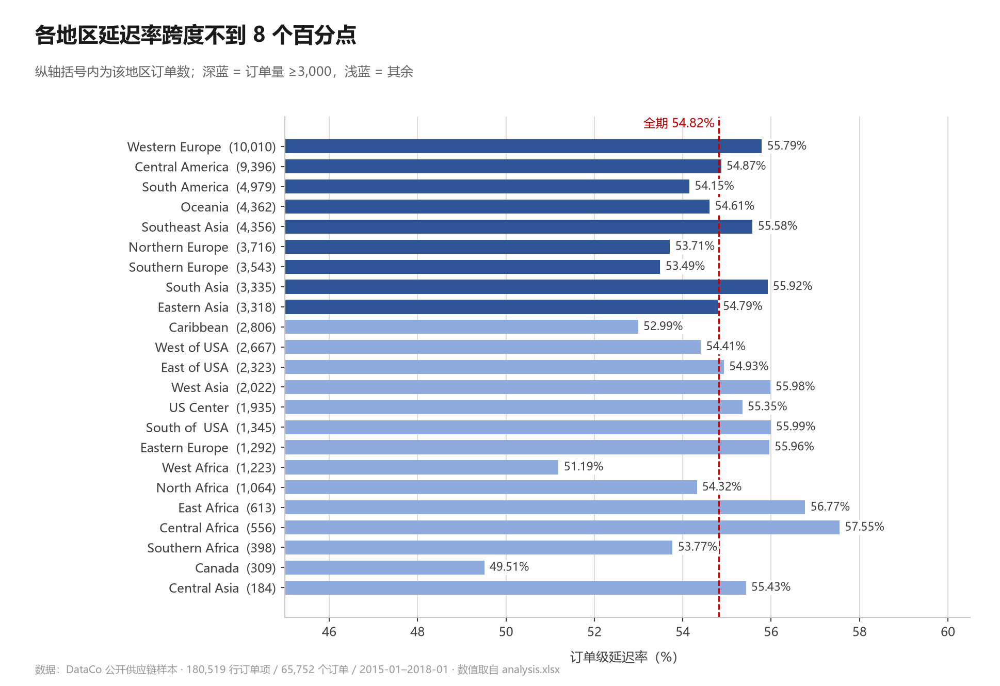
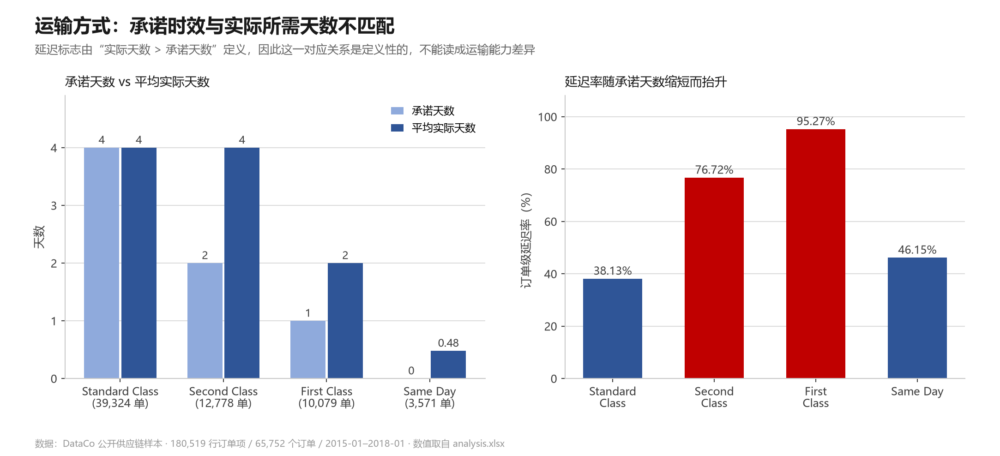
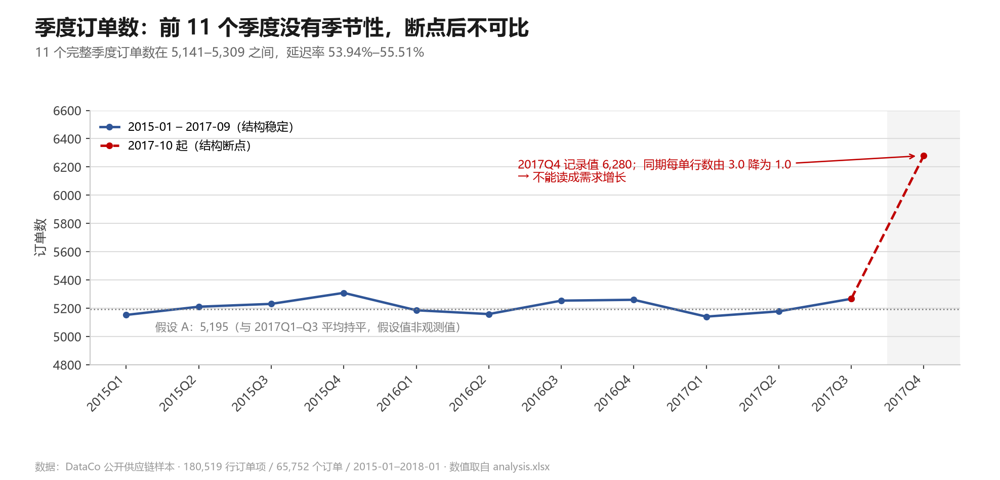
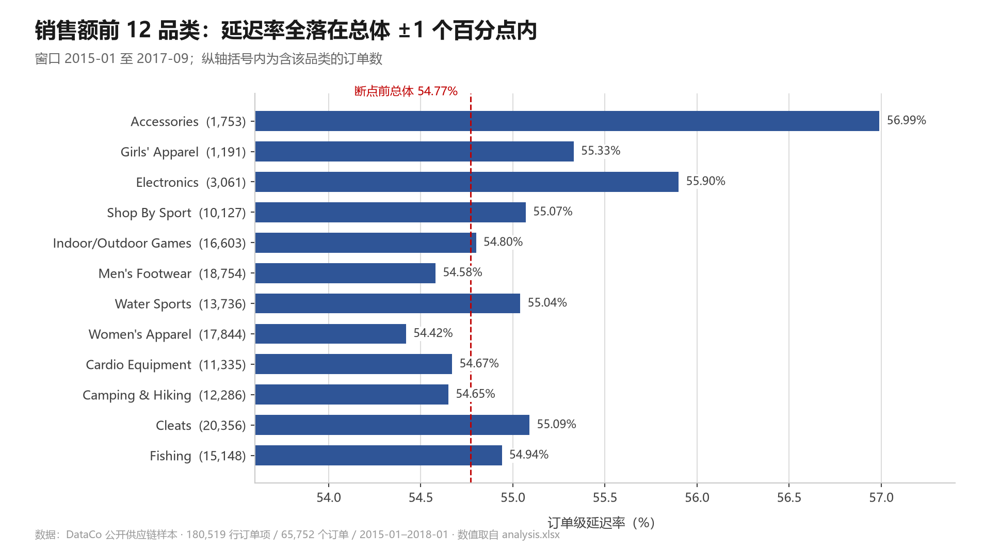
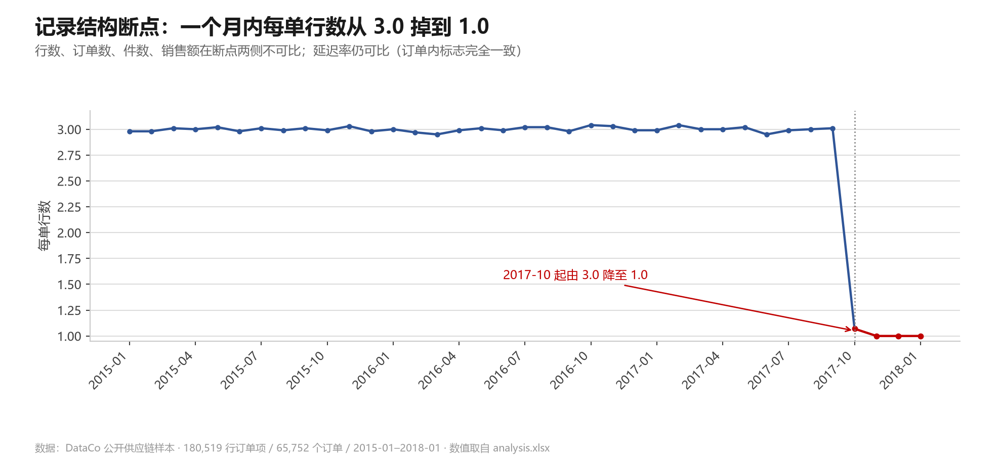
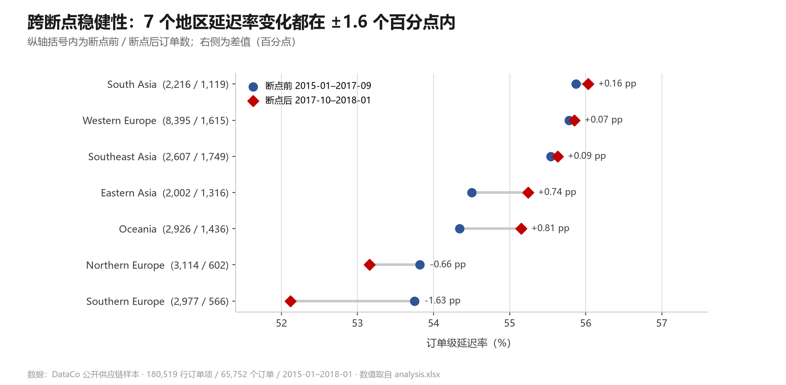

# 供应链与配送履约分析


> 用一份公开的供应链订单数据，回答四个业务问题：**延迟出在哪个环节、影响多大、应该先改什么**。
> 每个结论都用 SQL、pandas、Excel 三条独立路径各算一遍，三方对不上就不写进结论。

---

## 目录

- [1. 这个项目回答什么](#1-这个项目回答什么)
- [2. 数据](#2-数据)
- [3. 方法：同一批数字算三遍](#3-方法同一批数字算三遍)
- [4. 四个结论](#4-四个结论)
- [5. 稳健性：2017-10 的记录结构断点](#5-稳健性2017-10-的记录结构断点)
- [6. 局限（比结论更重要）](#6-局限比结论更重要)
- [7. 仓库结构](#7-仓库结构)
- [8. 如何复现](#8-如何复现)
- [9. AI 协作是怎么做的](#9-ai-协作是怎么做的)
- [10. 作者](#10-作者)

---

## 1. 这个项目回答什么

物流运营里最常见的提问是：配送延迟出在哪个环节，影响多大，应该先改什么。本项目把这类提问拆成 4 个能用数据回答的问题，并为每个问题定死指标口径：

| 题号 | 业务问题 | 交付物 |
|---|---|---|
| Q1 | 哪些地区延迟率高且订单量大 | 地区级延迟率与延迟订单量排序 |
| Q2 | 各运输方式的承诺时效是否匹配 | 承诺天数 vs 平均实际天数、各方式延迟率 |
| Q3 | 订单量在各季度如何波动，哪些季度要提前备料 | 季度订单数与季节性判断 |
| Q4 | 哪些品类量大、销售额高但履约差 | 品类销售额与延迟率交叉 |

目标不是做一份好看的报告，而是证明一件事：**每个结论都能追溯到某条查询的某个输出，并且知道它在哪里不成立。**

---

## 2. 数据

| 项目 | 值 |
|---|---|
| 数据集 | DataCo Smart Supply Chain（公开样本，**不是企业真实数据**） |
| 来源 | Kaggle 公开数据集，原始文件 `DataCoSupplyChainDataset.csv`，约 96 MB，ISO-8859-1 编码，CRLF |
| 规模 | 180,519 行订单项 × 53 列，65,752 个订单，2015-01 至 2018-01 共 37 个月 |
| 行的含义 | 一行 = 一个订单项；同一订单可以有多行（断点前平均每单 3 行） |
| 分析库 | SQLite `data/orders.db`，表 `orders` + 视图 `orders_v`，只读访问 |

数据集不随仓库上传（原始 CSV 约 96 MB、SQLite 库约 91 MB），下载后放回 `data/raw/` 再跑导入脚本即可，见 [如何复现](#8-如何复现)。

数据里有两个必须先知道、否则会读错结论的特征：

1. **`Late_delivery_risk` 是定义出来的标志**：由"实际天数 > 承诺天数"计算得到，不是外部观测的迟到事件。所以它与运输方式的关系是定义性的，不是因果。
2. **2017-10 存在记录结构断点**：每单行数在一个月内从 3.0 降到 1.0，量类指标（行数、订单数、件数、销售额）从此不可比。

---

## 3. 方法：同一批数字算三遍

这是本项目与常见"跑几条 SQL 出图"的分析最大的区别：**每个问题同时用三条互不依赖的路径计算，数值不一致就查原因，查不清就不写结论。**

```
CSV 体检（pandas + Excel 逐格比对）
  → 清洗决定（不删行，不改原始文件）
  → 导入 SQLite（断言 180,519 行 / 65,752 单 / 37 个月，不符即报错）
  → 定稿指标口径（docs/metrics.md）
  → 注册只读 MCP（mode=ro + PRAGMA query_only 双层保护）
  → 三路计算：SQL ／ pandas ／ Excel 公式（各自独立写，互不参考）
  → 三方比对记录（docs/validation.md）
  → 断点分析（docs/break_analysis.md）
  → 业务报告（docs/ops_report.md）+ 分析簿 analysis.xlsx
```

三条路径的分工与独立性：

| 路径 | 实现 | 独立性保证 |
|---|---|---|
| SQL | `sql/queries.sql`，经 `sqlite-readonly` MCP 执行 | 只读连接，服务端 `mode=ro` + `PRAGMA query_only` |
| pandas | `scripts/03_validate.py`，自己写聚合函数 | **不读 `queries.sql`**，只看表结构 |
| Excel | `scripts/04_excel_q*.py`，用 `COUNTA`／`COUNTIFS`／`SUMIFS`／去重向导 | 不导入任何 Python 计算结果 |

核对通过标准（全部满足才算通过）：

- 计数完全相等；
- 比例差值 ≤ 0.01 个百分点；
- 金额差值 ≤ 0.01。

四个问题加断点后的补充核对**全部通过**，逐条记录见 [`docs/validation.md`](docs/validation.md)。

---

## 4. 四个结论

### Q1 地区配送延迟：没有哪个地区明显更差

全期订单级延迟率 **54.82%**（36,048 / 65,752）。23 个地区的延迟率都在 49.51%–57.55% 之间，跨度不到 8 个百分点；单量最大的 Western Europe（10,010 单）只比总体高 0.97 个百分点，接近抽样波动。



**可执行的动作**：既然延迟率没有地区差异，资源就不该按"延迟率高"排序，而应按**延迟订单的绝对量**配置——西欧 + 中美洲合计占全部延迟订单的 29.8%。

### Q2 运输方式：承诺时效与实际所需天数不匹配

承诺天数越短的方式，延迟率越高。原因不神秘：延迟标志就是这么定义的。



| 运输方式 | 订单数 | 承诺天数 | 平均实际天数 | 延迟率 |
|---|---:|---:|---:|---:|
| First Class | 10,079 | 1 | 2 | **95.27%** |
| Second Class | 12,778 | 2 | 4 | **76.72%** |
| Standard Class | 39,324 | 4 | 4 | 38.13% |
| Same Day | 3,571 | 0 | 0.48 | 46.15% |

**这不是"运输能力差"的证据**，而是承诺设置的问题：真正可执行的动作是把 First Class 与 Second Class 的承诺天数按实际所需重设。承诺不改准，延迟率这个指标就没有信号。

### Q3 需求节奏：没有季节性，且断点后不可比

断点前 11 个完整季度的订单数在 5,141–5,309 之间，延迟率 53.94%–55.51%，**没有季节性**。2017Q4 记录值 6,280（约 +19%），与记录结构变化同月发生，无法区分，主口径按"与前三季持平"（假设 A：5,195）处理。



更重要的是：行数、订单数、件数、销售额四个需求代理在断点两侧方向都不一致（−59%、+21%、−81%、−39%），**这份数据不能用来做排产或备料参考**。

### Q4 品类：不存在"量大、销售额高、履约又差"的品类

断点前窗口里销售额前 5 的品类延迟率 54.42%–55.09%，与总体（54.77%）差距都在 1 个百分点内。



延迟与品类无关，指向各品类共用的环节——回到 Q2 的配送时间承诺。延迟率最高的小品类（Golf Bags & Carts 68.85%，61 单）只是 2.4 个标准误的偏离，在 32 个品类同时比较下不构成异常。

### 综合建议的顺序

1. 重设 Second Class 与 First Class 的承诺天数；
2. 按延迟订单数配置核查资源（西欧、中美洲）；
3. 索取 2017-10 的记录方式说明，再谈需求分析；
4. 品类层面不动作。

详见 [`docs/ops_report.md`](docs/ops_report.md)。

---

## 5. 稳健性：2017-10 的记录结构断点

数据集在 2017-10 发生记录结构变化，每单行数在一个月内从 3.0 掉到 1.0：



处理方式是**逐指标判定可比性**，而不是简单截断或忽略：

- **量类指标不可比**（行数、订单数、件数、销售额），涉及量的结论一律限定在同一窗口内；
- **率类指标仍可比**（延迟率、运输方式占比、折扣率）。原因是 `Late_delivery_risk` 实际按订单整体赋值——45,902 个多行订单中 0 个出现订单内标志不一致，所以每单行数怎么变都不影响延迟率。

据此对 Q1 做了跨断点复核，7 个两段都出现的地区延迟率变化都在 ±1.6 个百分点内：



判定过程与证据见 [`docs/break_analysis.md`](docs/break_analysis.md)。

---

## 6. 局限（比结论更重要）

1. **公开样本，不是企业数据。** 实际天数在 2–6 天之间近似均匀分布、First Class 恒为 2 天，这个形态不像真实物流运营，更像生成数据。所有结论只说明这份数据集的结构，不能直接搬到真实业务。
2. **2018 年只有 1 月**，不做任何 2018 年的结论。
3. **2017-10 断点**破坏了"量"的可比性，涉量结论只在单窗口内成立（见上一节）。
4. **没有因果结论。** 运输方式与延迟的关系是定义性的，不是"这种运输方式导致延迟"。
5. **小样本只作线索。** 地区层面延迟率最高和最低的两个地区都不足 700 单；品类层面只有 10 个品类达到 2,500 单的量级。
6. **口径特殊性不外推。** 订单级与行级延迟率在本数据中只差 0.005 个百分点，这是"订单内标志完全一致"的结果，换一份数据不成立。

---

## 7. 仓库结构

```
supply-chain-analysis/
├── README.md                    本文件
├── analysis.xlsx                分析簿：总览 + Q1–Q4 每题一表一图 + 断点与断点后
├── requirements.txt
├── LICENSE
├── sql/
│   └── queries.sql              4 个问题的 SQL + 断点分析 1–8，注释写明口径
├── scripts/
│   ├── 01_profile.py            CSV 体检（只读）
│   ├── 01_excel_check.py        Excel 逐格核对
│   ├── 02_load.py               导入 SQLite（带断言）
│   ├── 03_validate.py           pandas 独立复算（Q1 Q2 Q3 Q4 + 断点系列）
│   ├── 04_excel_q1..q4.py       Excel 侧复算
│   └── 05_build_analysis.py     重建 analysis.xlsx
└── docs/
    ├── README.md                文档索引与阅读顺序
    ├── data_check.md            数据体检、Excel 核对、清洗决定
    ├── metrics.md               指标口径（含断点后假设口径）
    ├── validation.md            三方核对记录：SQL vs pandas vs Excel
    ├── break_analysis.md        断点成因分析与可比性重判
    ├── ops_report.md            面向业务的结论与建议
    ├── images/                  README 用图表（由 analysis.xlsx 数值重绘）
    └── process/                 过程记录：项目计划、操作流程、AI 协作日志、MCP 配置
```

---

## 8. 如何复现

**前置**：Python 3.10+，`pandas`、`openpyxl`（`pip install -r requirements.txt`）。

```bash
# 0. 下载 DataCo 数据集，放回 data/raw/
#    确保文件名是 DataCoSupplyChainDataset.csv（ISO-8859-1，无 BOM，CRLF）

# 1. 体检（只读 CSV）
python scripts/01_profile.py "data/raw/DataCoSupplyChainDataset.csv"

# 2. 导入 SQLite —— 断言 180,519 行 / 65,752 单 / 37 个月，不符即报错退出
python scripts/02_load.py "data/raw/DataCoSupplyChainDataset.csv" "data/orders.db"

# 3. pandas 独立复算（参数可选 Q1 Q2 Q2S Q3 Q3M Q3S Q4 Q4P Q4S BREAK Q1B）
python scripts/03_validate.py Q1

# 4. 重建分析簿（覆盖 analysis.xlsx，不要在该文件里手工编辑）
python scripts/05_build_analysis.py
```

SQL 侧：任意只读客户端连 `data/orders.db` 执行 `sql/queries.sql` 的各段即可。原作者用 `sqlite-readonly` MCP 执行，配置见 [`docs/process/mcp_setup.md`](docs/process/mcp_setup.md)。

**Excel 侧复算（可选）**：`scripts/04_excel_q*.py` 通过 `win32com` 驱动本机 Excel，需要 Windows + Excel，并准备 `data/工作簿2.xlsx`。没有 Excel 也能完成 SQL 与 pandas 两条路径的核对。

---

## 9. AI 协作是怎么做的

项目由人与 AI 协作完成，协作过程没有被隐藏：`docs/process/ai_log.md` 记录了 11 条"问题 → AI 输出 → 我的判断 → 修正"，包括 AI 算错被复核抓到的例子（例如早期"总体延迟率 54.83%"与按订单级重算的 54.82% 对不上，是重建分析簿时暴露出来的）。

三条硬规则：

1. **AI 不接触原始文件写入**——`data/raw/` 只读，分析簿由脚本重建；
2. **三路计算必须独立**——pandas 复算不看 SQL，Excel 复算不导入 Python 结果；
3. **不确定就写成假设**——例如 2017Q4 订单数的三种口径（记录值 6,280 / 假设 A 5,195 / 假设 B 2,146），正文明确标"假设值非观测值"。

---

## 10. 作者

**wuwangsyz** — 数据分析 / 供应链运营方向。

- 项目定位：把"配送延迟"这类模糊提问拆成可验证的指标，并用多条独立路径防止单点算错。
- 反馈与讨论：欢迎开 Issue。
